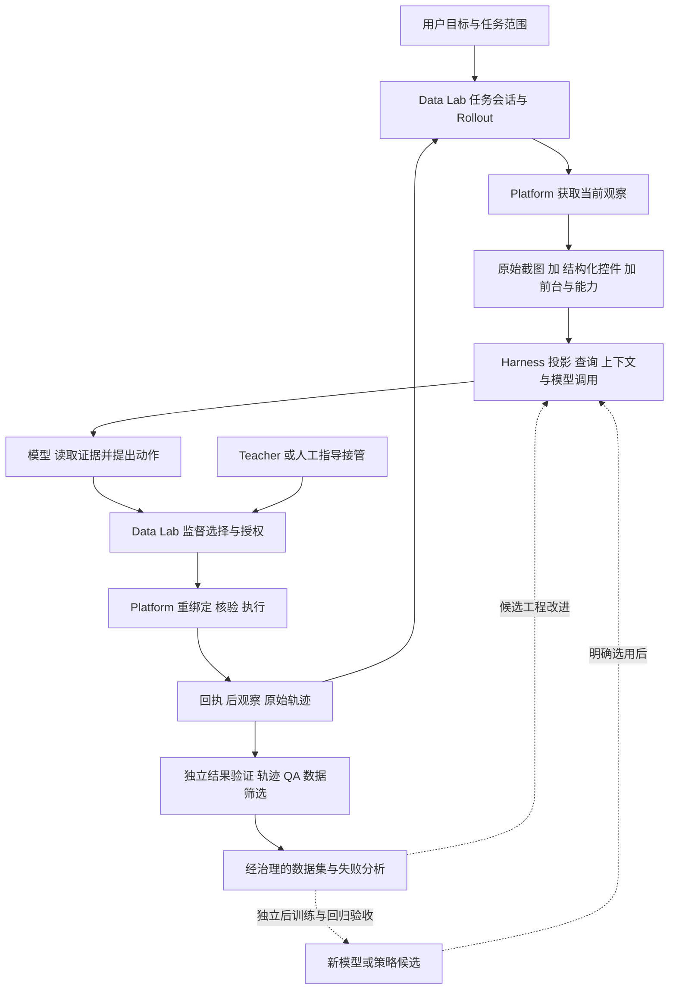
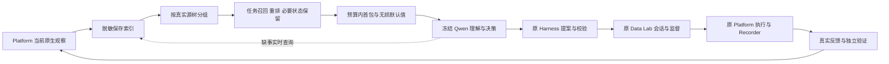

# Mobile GUI VLA 架构与进展交接

核对日期：2026 年 10 月 28 日，北京时间。接收者：项目参与者及后续制作 PPT 的 Agent。

这套工程的目标是建立可持续改进的 Android GUI Agent：从真实手机获取证据，让模型选择可验证的动作，在需要时接受 Teacher 或人的帮助，保留完整后果与成本，再把经筛选的数据、失败分析和候选改进反馈到下一轮。它不是只有“截图发给大模型、ADB 点一下”的脚本，也还不是已经完成大规模自动学习的系统。

本交接按四部分组织：Data Lab、官方交互 Harness、Platform 与人工调试、私有结构化 GUI 信息策略。后训练属于它们的下游，不作为第五套手机控制系统。文末提供架构图、可直接制作 PPT 的页序、证据入口和不能混淆的结论。

本次“云端核对”指 GitHub 远端代码、分支和提交，不代表已登录云 GPU 服务器核验运行服务。已 fetch 远端，未切换团队工作树、未修改团队源码、未操作手机或调用付费模型。完整提交清单见同目录 [source-versions.json](source-versions.json)。

## 1 整体关系与当前版本

### 1.1 四部分分别解决什么问题

| 部分 | 核心问题 | 主要产物 | 不承担的职责 |
| --- | --- | --- | --- |
| Data Lab | 任务如何持续运行、谁来指导、怎样采集与筛选数据 | 任务会话、rollout、监督来源、人工介入、QA、导出、改进实验记录 | 不直接训练所有模型，不另建手机执行旁路 |
| 交互 Harness | 模型看到什么、怎样调用工具、如何维持长任务上下文 | 输入投影、可查询观察、工具协议、动作提案、历史/预算、策略接口 | 不因模型说“点击”就绕过执行端 |
| Platform | 如何可靠观察和执行，动作究竟有没有发生 | 不可变观察、当前能力、原生/像素执行、原始轨迹和后观察 | 不负责策略优劣、Teacher 决策或训练资格 |
| 私有结构化 GUI 尝试 | 在有限预算内，首轮给模型哪些最有用的信息 | 任务召回/重排、无损压缩、可查询细节、页面记忆、信息策略实验 | 不替换官方执行器，不把未训练的网络称为学习成果 |

**命名澄清：**平时打开的“platform”网页是整个采集/调试产品的操作界面；当前主要浏览器前端实际在 Data Lab 的 `web.py` 等模块。`mobile-gui-vla-platform` 仓库提供其下面的观察、动作和 raw 轨迹底座。因此，“Data Lab 自动采集”和“Platform 人工调试”并不是两套互斥系统；同一底座可服务人、模型和 Teacher。

### 1.2 远端能力分布

官方能力不是已经全部合并的一条分支。讲解时应使用“团队仓库的以下版本组合”，而不是笼统说 main 已发布全部功能。

| 仓库 | 已核对的重要远端版本 | 讲解用途 |
| --- | --- | --- |
| `chbq/mobile-gui-vla-data-lab` | main `86bcae3`；structured-action-handoff `92b4a14`；student-agent-harness `36a3223`；Windows observer-console `bfb285e`；Windows GLM read-return `5997e4b`；JEV `08fd358` | 公共职责、生产接线、持续改进、可选控制台/目标就绪、实机进展 |
| `chbq/mobile-gui-vla-baseline-diagnostic` | main `8f4a97e`；harness-roadmap-completion `90e5215`；student-agent-harness `abfd6df`；JEV `3d58c5d` | 模型/策略职责、按需观察与动作、上下文、最新 JEV 计划 |
| `chbq/mobile-gui-vla-platform` | main `1288608`；windows-observation-clock `c4a93a6` | 已合入 JEV/native text/action coverage 的设备底座；另有 Windows 候选改进 |
| `coisini233333333/mobile-gui-vla` | `codex/task-aware-local-ranking-v0.1`，`b4e6115` | 私有信息策略与最新四应用诊断 |

上表中同名路线不表示可任意互换依赖。一次运行要固定实际加载的三仓来源、模型/协议、观察后端、动作空间和预算。私有最新实验固定 Harness `90e5215`、Platform `1288608`、Data Lab `92b4a14`，没有自动吸收所有更新分支。

### 1.3 一次任务的真实数据流



实线是运行/采集链，虚线是需要另行验收的改进链。模型提案、动作执行、观察到效果、任务成功、训练准入是五个不同的判断。

## 2 Data Lab 持续改进与 AI 数据采集

### 2.1 定位与运行组织

Data Lab 是模型中立的受控 rollout、监督和数据生产层。它能服务纯人工示范、模型自主运行、Teacher 标注、Teacher 纠正以及人机混合恢复；“大模型指导小模型”只是其中一种运行方式。

核心 `TaskThread`/任务会话属于 Data Lab：保存目标与修订、上下文 epoch、模型可见 guidance、AgentStep、人工接管段和事件。任务修订或指导会让未决提案失效，防止在新目标下继续执行旧动作。真实设备观察、fresh rebind 和动作 dispatch 仍交给 Platform。

生产入口复用持久 actor → 原生工具/反馈 → TaskThread → Platform 执行。生产 Worker/外层运行环境组织阶段预算和产物目录；Data Lab 的调用互斥保护同一 journal，Platform 的 device/session lock 是实际设备执行的互斥边界。同一手机不得由多个入口并发操作，运行入口还需遵守同一设备的共享锁约定。

### 2.2 AI 采集如何发生

```text
任务版本和当前观察
  → Student 提案
  → 可选 Teacher 分析/标签
  → 显式监督策略选择执行来源
  → Platform 实际动作及后观察
  → 记录提案、谁被选中、执行后果、人工介入与模型成本
  → 独立验证和逐用途筛选
```

已有监督语义包括 Student-only、DAgger label-only、显式 Teacher override、异步延迟标签，以及 Teacher demonstration。它们的含义不同：label-only 不替换执行动作，延迟标签不作为当下执行指令，override 必须声明覆盖规则。Worker、Student、Teacher 是角色，不必等同于固定大小的模型。

人的目标指导、Teacher 建议和实际手机动作分别记录。Teacher 的分析需要绑定已完成步骤；人工修复不能被改写成 Student 自主完成。模型返回 done/report 或 Teacher 说成功，都不能替代独立结果判据。

### 2.3 数据分层与质量门

| 层 | 保存什么 | 为什么分开 |
| --- | --- | --- |
| Platform raw | 帧、观察、请求动作、实际路由、回执、前后 transition、pending 状态 | 保留发生过什么，避免后写标注覆盖事实 |
| Data Lab episode/annotation | 谁提议/执行、监督模式、干预、目标/结果说明、独立标签 | 解释事实的用途和来源 |
| QA 与 selection manifest | 引用/hash、未决项、未知后果、用途筛选与接受范围 | 防止孤立轨迹、错误配对和不明后果进入数据集 |
| deterministic export | 按声明 schema 导出的 model-neutral JSONL | 给后训练一个明确、可复核的数据合同 |

QA 不自动重放不确定动作。整个任务最终成功，也不自动证明每一步都是好训练样本。当前 structured API debug trial 默认 `training_eligible=false`；即使轨迹 QA 全通过，也需要另外的数据治理、用途审核和导出过程。

### 2.4 持续改进和 RSI 的具体对象

现有可选 RSI 流程把“任务内协作”和“任务外工程迭代”分开：

1. 固定公开目标、起始条件、Student 身份、运行预算与独立评价方式。
2. 保留一次实际运行的提案、后果、失败、成本和 Verifier 诊断。
3. 由 owner 在候选分支修改策略、提示词、工具接线、数据处理或可公开经验文本。
4. 在新进程和预定同条件任务中比较 candidate 与 incumbent，记录失败和反例。
5. 明确选择版本；后续 fresh Task 真实加载并使用，才算候选已被采用。

这不是任务中偷偷更新 Qwen 权重，也不是自动 promotion。创建文件、写入 notes、修改 AGENTS 或一次成功，都不构成能力提升证明。若要 SFT/LoRA，需走独立的训练、检查点和匹配回归链。

跨任务经验来自已结束且允许引用的记录，以历史声明提供给模型；不能当作当前手机事实。Student workspace 接口支持受限 materials/notes/instructions 操作；RSI 的 materials 是受限公开文本，不是任意文件系统挂载。Data Lab 不因这些输入本身授予设备 I/O；外层 Worker/Agent 可用哪些 shell、工作区工具、MCP 或技能，仍取决于其实际配置和权限，不能用这个输入接口概括整个 Agent 的能力。

### 2.5 最新分支进展及边界

- `36a3223`：可移植 RSI 准备和 Teacher 身份流程。可选原生 Teacher 是控制平面角色，需要与 Worker/Verifier 区分；公共指导经 call-id/ACK 进入 Student 后续正常请求，不能清除设备效果 unknown。
- `bfb285e`：可选 Windows observer-console，加入 worker planning、候选审查/导出和训练输入诊断；主要以 fixture/fake Student/Teacher/device 验证，不等于跨 OEM 实机成熟。
- `5997e4b`：可选 node-scoped readiness，尝试允许局部变化区之外的稳定目标。它比较两份完整、无敏感/截断、同前台/几何/层级/epoch、15 秒内的不可变 UIA 观察；QA 回读原始证据，最后仍由 Platform 重绑。**当前仅针对 UIAutomator 来源，不能直接当作私有 Accessibility 动态页面问题已解决。**

上述分支不是 main 的默认行为。readiness 相关 focused/console 检查通过，但同分支完整 rollout core 仍有 3 项在旧 Platform source-hash guard 失败，不应写成“全库全绿”。

## 3 官方交互 Harness 观察融合与上下文管理

### 3.1 它给模型提供运行环境

Baseline/Harness 负责模型接口、输入投影、工具协议、持续对话、快慢策略和动作提案解析。它把任务、已观察事实、能力目录、工具结果和真实反馈编成模型可以使用的上下文，而不是仅追加一句“请操作手机”。不同模型接入可以使用不同协议适配，但实际实验必须声明模型和动作合同。

### 3.2 结构化 GUI 与截图怎样结合

结构化信息来自 Android 的控件树/能力描述，包含文本、content description、resource-id、class、层级、bounds、可见性、enabled/editable/selected 等状态与原生 action IDs。APK Companion 复用 Android AccessibilityService/AccessibilityNodeInfo；UIAutomator 是另一条观察后端。它不是自动读到所有业务 API、数据库或软件说明书。

截图与语义树是同一份 PlatformObservation 中可追溯的并列证据；它们顺序采集，不保证来自完全相同的瞬时屏态。官方已有可比较的输入模式：

| 模式 | 模型得到什么 | 适用问题 |
| --- | --- | --- |
| O-Full | 全部允许暴露的结构化字段及动作绑定 | 完整信息基线 |
| O-Compact | 紧凑字段、状态与长文本预览 | 减少重复信息 |
| O-Query | 首包概览，加保存快照的按需查询工具 | 大页面和缺失细节 |
| O-Hybrid | O-Query 加明确启用的原始截图裁剪 | 自绘控件、标签不足、布局/图像语义 |

这是 Harness 层的多模态证据组织，不是已经训练了一个新的视觉—控件融合网络。原视觉 baseline、结构化分支和 hybrid 的默认条件不同，不能把“结构化优先”说成所有官方入口的统一默认。

`SnapshotRepository` 先脱敏再索引正式观察。模型可调用 read/find/expand/inspect/compare/batch 等工具，读取保存源的节点、区域、字段或历史差异。`read_visual_region` 默认关闭；开启后裁剪同一份已保存 PNG，不暗中重新截屏，敏感/隐藏/外包区域按规则遮蔽。

模型只有实际收到当前视觉裁剪，并满足图像来源、原像素范围和后续执行检查，才可提出相应坐标动作。不能因为“结构化节点点不了”就自动降级成像素点击。未暴露的信息是 unknown，不代表页面中不存在。

### 3.3 上下文管理不只是截断聊天

- 当前快照、动作目录和工具调用源绑定；旧页面可以读历史，但不能凭旧句柄执行当前手机。
- 查询次数、返回数据字节、错误/批次开销和完整 messages+tools 请求大小分别计量。8 KB 概览不等于整个模型请求，也不等于固定 Token 数。
- 保留最近含真实设备反馈的完整 native batch。对能确实读回的旧 UI 正文做机械卸载，换成 `check_history(step=...)` 引用，而非随意生成语义摘要。
- assistant/tool 原生配对不能拆散；未知效果、混合批、不可读事件不能被卸载后当作已解决。
- 实际反馈、历史经验、模型自己的 public plan 和人工 guidance 各有来源；笔记/模型解释不能升级成设备事实。
- 预算耗尽或来源不可用时停止/重规划，不要求模型猜测合法动作。

价值在于长任务仍能知道“已经做过什么、后果是否确定、需要时到哪里回读”。上下文机制可用不等于当前长任务效果已经达标。

### 3.4 动作提案和 ADB 点击设计

模型输出结构化 tool call，Harness 严格解析并核对当前候选/能力目录。Data Lab 按监督与授权选源后，Platform 再重绑并执行。

| 路由 | 模型提供什么 | 真正执行与限制 |
| --- | --- | --- |
| 节点点击 | 当前候选 ID | 重观察/唯一匹配后尝试原生 ACTION_CLICK；候选不是任意坐标 |
| 原生文字 | 当前 `set_text_node` target 与文本 | ACTION_SET_TEXT 完整替换字段；非密码、可见可编辑且实际广告该能力；不是键盘搜索提交 |
| 原生滚动 | 当前 `scroll_node` target 与方向 | ACTION_SCROLL_FORWARD/BACKWARD，语义方向不伪装成手指 swipe |
| 显式像素点击 | 已看过且绑定来源的原图像素坐标 | 单独授权和 freshness 检查；经 ADB/input 路线执行，不能自动兜底 |
| 系统/手势 | 当前协议允许的 Back/Home/Wait/Swipe 等 | 依模型/任务 profile 与授权开放，不是任意 shell |

扩展 coverage policy 默认关闭。打开后仍核对包名、禁止动作、完整来源、可见/可用/隐私状态、实际能力、observation ID 和 catalog digest。真正 dispatch 需要明确执行权限；模型 JSON 合法不代表已经执行。

ADB 在这里既是连接/采集与部分动作的传输，也可用于访问 Companion；**原生节点动作并非全部翻译成 `adb shell input tap x y`。** Companion 可直接调用 Android 节点动作；显式像素路线才使用像素坐标输入。可见按钮可能由自绘、点击父容器或特殊业务组件实现，视觉上可点，不等于该节点支持 Accessibility ACTION_CLICK。

早期 ADBKeyboard 输入法桥接解决过中文注入；后续原生 SET_TEXT 是另一种 route。旧 `text_input.py` proposal beta 本身拒绝执行，后续 coverage/Platform 原生文本链路才提供受控 dispatch，不能把所有“文字输入支持”混为一个实现。

### 3.5 策略与实机进展

已有持续慢模型、快选择器/慢模型路由、Teacher/Student、JEV 等路线。它们应记录真实模型与策略身份，不能把确定性规则称为学习型网络，也不能把“支持快慢协同”当作已经证明省钱。

最新 JEV 远端计划回填了历史 API 实机复杂任务：世界时钟/秒表一轮有独立七项检查、20 次决策、19 动作、44.354 秒，决策 P50 681.76ms，12/20 决策低于 800ms。**该轮是旧 Max + 旧 Flash、特定代码与任务条件，不是当前 Plus/Flash 或所有应用的性能。**

笔记任务曾有保存、搜索重开、修改、再打开的有序证据，但早期 hybrid 含专用阶段规则。计算器连续任务有模型完成声明/录像，独立末态仍待核验，不能直接算独立成功。当前 Flash/Plus 跨软件长任务接线与恢复已推进，完整通过、通用成功率、成本优势和训练收益仍需复验。

最新 JEV 计划还说明：历史成功运行的部分源码曾分散在本地未跟踪工作区，`3d58c5d` 包含归档与收纳计划，不能表述成“一个远端提交已完整复现全部历史结果”。

Student workspace 和历史窗口也已有真实 API 接口演练，但不等于真实手机长期记忆/自我改进成立。历史演练与最新私有四应用实验是不同分母。

## 4 Platform 与人工调试能力

### 4.1 统一观察和执行证据

Platform 顺序采集前台、原始 PNG、语义树和前台复核，形成不可变 `PlatformObservation`：观察 ID、帧 hash、原尺寸/旋转、时钟、前台、来源/epoch、节点及能力/降级信息。语义源失败时仍可保存截图，但不能伪装成完整控件来源。

`ObservationView` 提供预算内的可读投影；完整证据留在原始层。动作前重新观察并匹配目标，校验同包、字段、状态、几何、唯一性与时效。partial/truncated/error、密码、隐藏、disabled、歧义或过期等会拒绝。dispatch 后做 bounded settle 和新观察，命令返回不直接判任务成功。

`TrajectoryRecorder` 以 append/fsync 的事件和帧文件记录动作意图、pending/completed、实际路由、重绑定动作、回执和后状态。未确定完成的动作不自动重放；录屏可辅助诊断，但不替代逐步观察证据或成为干净时延测量。

### 4.2 人工界面为何有价值

浏览器 collector/observer-console 与 Platform 的组合，让人能在同一条证据链内准备初态、发布目标、看模型提案、给指导、接管纠正、继续执行、复核末态和标注原因。

| 操作环节 | 人能获得的能力 | 对研发和数据的意义 |
| --- | --- | --- |
| 准备 | 选择设备、任务、采集者和起始页面 | 把环境准备与模型动作分开 |
| 观察与单步 | 查看画面、候选、意图和实际反馈 | 定位“没看见、选错、执行被拒、效果不符”是哪一层 |
| 指导/接管 | 修订目标、添加 guidance、人工示范后交回 | 避免为每个错误重新启动任务；保留干预来源 |
| 复核 | 成功/部分/失败/中止/环境问题及说明 | 不依赖模型自报成功 |
| 数据管理 | raw 与 annotation 分离、QA/manifest/export | 可追查修复、失败和训练候选的来源 |

这是可观察性、可控性与归因能力上的设计优势，尚不是“人工调试使模型准确率提高多少”的实验结论。并非所有入口都默认具备同一面板，浏览器 collector 和新 observer-console 也要区分版本。

同一基础设施也服务正常 Agent 运行，不是“只有研发时用、生产就不用 Platform”。真正可以不带的是人工网页前端，而不是设备执行、证据和授权底座。

### 4.3 Windows 和设备适配

已做 Windows 启动/编码、设备发现、ADB/锁接线、手机坐标与观察适配。官方另有 `c4a93a6` Windows 时钟候选修复与 opt-in Android UIAutomator compressed capture；不是默认 host 去重，也不是私有 v4 压缩算法。

不同 vivo/Huawei/Samsung 等设备有系统/OEM授权、ADB连接、后台冻结、输入法、原生节点暴露与界面尺寸差异。应核对当前设备与 App 版本，而非套用历史机型名称。官方某些受控设置页、模拟器 JEV 场景和 Data Lab 消费链已有工程证据；这些不代表所有 OEM/软件已经适配。

官方 Platform 没有内置万能 OCR/视觉推理器。`VisionEnricher` 是外部只读增强协议接口；Harness 已保存图像裁剪与“训练一个视觉融合网络”属于不同层。

## 5 私有结构化 GUI 信息策略尝试

### 5.1 研究问题和复用关系

官方 O-Query 解决“模型可以查询什么”；私有分支继续研究“面对当前任务，第一包主动给什么，缺什么再查询”。完整树很大时，无脑全塞会消耗预算；完全靠模型层层查询也会增加往返、重复上下文和错误机会。



首包主动推送：任务相关标签、当前值、必要状态、真实动作选项、有限上下文；保留 unknown 和隐私语义。按需查询：完整字段、未推送区域、子树、历史差异，以及未来同源视觉补充。动作候选、查询引用、历史页引用是不同类型，不能拿 `n:17` 或旧页句柄直接当可执行目标。

### 5.2 v4 已实现

- 正负意图分离，以词项/单位/可调控件等召回；它是启发式而非完备语义理解。
- 必要状态拆为小 fragment，防止一个 selected 节点把整批普通兄弟变成必选。
- 任务匹配的真实可执行控件与标签优先；只穿明确非动作 wrapper，遇到不合格动作边界停止关联。
- 最多保留两个小型顶部无标签可点控件，仍标含义未知；不硬编码“这就是搜索”。
- 对重复 parent/class/native-actions 采用包级无损默认值，显式值覆盖；false/null/空列表不混同。
- 不可见且无可执行能力的普通组留在可查询源中，不挤占首包；必要状态不删。
- 页面记忆仅记录已观察 viewport 与有实际动作证据的转移，路线提示 `executable:false`，到下一页必须重观察。
- 保留原 on-demand、候选/coverage、TaskThread、共享锁、Platform 重绑和 Recorder；不新增裸 ADB 执行通道。

规则 v4 的分片、顶部召回和过滤没有套到 network/bandit 臂，以免改变其采样合同。旧版本 checkpoint 显式拒绝。私有 exact-copy runtime 还处理原生能力的保守兼容与主机时钟微小倒序；它们不是团队默认行为。

### 5.3 已有证据及不能推出的结论

10 月 27 日四应用最新一轮禁用 UIAutomator，不向 Qwen 发图，无页面记忆；模型是 qwen3.8-27b。六份已保存真实原生来源同源回放：

| 页面 | v3 | v4 首包 bytes | 关键覆盖 |
| --- | --- | ---:| --- |
| 爱奇艺首页 | 必要组超预算 | 8149 | 搜索入口 |
| 爱奇艺搜索 | 必要组超预算 | 8184 | 文字输入目标 |
| 红果首页 | 7911 bytes | 8047 | 两个真实但含义未知的顶部按钮 |
| 抖音首页 | 8163 bytes | 8119 | 搜索可点父及标签子 |
| 高德首页 | 8144 bytes | 8006 | 搜索父及标签 |
| 高德搜索 | 7951 bytes | 8131 | 原生 SET_TEXT 目标 |

六包均未超过 8192 bytes、源字段保真、必要状态无遗漏。这是覆盖和工程证据，不是四应用任务成功率，也不是 Token 节省比例。

最新高德实机例：185 节点原生源 → 8111-byte 首包 → 模型直接调用 `propose_coverage_action(set_text_node, t_017, 南京博物院)` → 原生 ACTION_SET_TEXT → 独立观察确认搜索框变化。1 次 API、1 次动作、无追加查询、无图片；输入 6578、输出 58 Token，API 2.633 秒，整轮 18.650 秒。未提交搜索。dispatch/执行完成/结构/引用 QA 全通过；debug 数据仍 `training_eligible=false`。

本轮全部 10 个落盘尝试共 5 次 API、33096 Token；不能仅展示成功案例。抖音/爱奇艺有模型前稳定性拒绝、选择器歧义和原生 stale_or_exhausted 失败；v4 没有绕过这些检查。红果尚不能证明模型已识别并完成搜索。

10 月 26 日更早的时钟 A/B 两臂都完成过闹钟→秒表，rule 总 Token 6900、mature 8714；但当时图片策略、记忆和 API 适配共同变化，rule 文本反而更多，不能把差额归因于重排。计时器任务中反复查询曾达到 38662/51128 Token 且失败，说明“按需”不天然便宜。更早两臂共同使用 UIAutomator，不能与最新纯 Accessibility 实验混成一组。

当前更可信的结论是：**任务相关首包有潜力减少不必要展开，并在一个实际原生输入任务中支持闭环；复杂控件、动态界面、误召回、无标签语义和真实成本优势仍待验证。** 最终代码回归 117 passed；测试数不能代替实机效果。

### 5.4 学习和视觉融合的后续方向

已存在 CPU `48→32→3` 小网络、监督初始化和单组 IPS contextual-bandit 更新代码。三个输出选择 omit/summary/detail，训练对象是信息粒度，不是直接点击动作；Qwen 权重冻结。没有真实学习型策略 checkpoint、云 GPU RL 或 PPO 结果。

RL 环境文档提出三层：保存快照验证信息合同；可复位沙箱真实 rollout 获取结果/成本反馈；真机做 held-out 迁移。奖励/成本分段、环境 wrapper、reset adapter、并行 worker 和新 reward 仍待落地。不能把历史成功奖励赋给从未重执行的新信息包。

最终计划把结构化信息与截图结合：控件给身份/状态/动作，图像补自绘/布局/未知语义；以后再评估何时查询节点、裁剪或整图。当前未选定最终融合策略。本轮纯结构化测试是隔离能力的实验条件，不表示要永久放弃视觉。

## 6 与后训练和工程恢复的关系

目标闭环是：失败/干预/成功轨迹 → 用途明确的候选数据 → QA/人工或规则验收 → Posttrain 转换与审计 → SFT/LoRA 等独立实验 → checkpoint → 匹配闭环回归 → 明确选择后部署。

`chbq/mobile-gui-vla-posttrain-diagnostic` main `e7355f5` 管理 Qwen3-VL-8B 的数据转换、配方、检查点和回归合同。冻结五动作 profile 接受 click/swipe/Back/wait/terminate-success，Type/Home 不在该训练合同内，不能因为当前 Harness 会输入文字就静默改写训练样本。动作扩展需要新 profile/转换/评估合同。

私有仓库还保留风险分级自动探索、App 目标生成、机器样本和多卡训练/恢复准备。这些是历史工程资产；不与最新 v4 原生任务分母混合，也不等于已经验证训练收益。RL 环境及多卡提案都不能代替已部署运行证明。

部署层把 Windows 主机/手机侧执行与云模型推理分开：本地持有设备、共享锁和手机会话；模型通过明确 API/SSH 隧道接入。源码、权重、数据和 checkpoint 依持久云盘恢复；镜像描述兼容环境，两者不同。密钥和临时手机令牌不进入 PPT、Git 或环境镜像。本交接不沿用历史服务器端口作为当前可用事实。

## 7 给 PPT 制作 Agent 的建议

### 7.1 一条贯穿的叙事

**我们在建设可观察、可控制、可改进的手机 Agent 工程：Platform 提供可信事实与动作，Harness 把证据组织给模型，Data Lab 将执行变成可用经验和数据，私有信息策略探索更高效的感知输入。**

不要按仓库提交历史逐项念功能。先画一个任务怎样流动，再解释四部分如何让它可运行、可调试、可改进。

### 7.2 建议 12 页，每页一个信息点

| 页 | 主要信息 | 建议画法与材料 |
| --- | --- | --- |
| 1 | 愿景：从一次点按到持续改进的手机 Agent | 目标—观察—行动—后果—改进闭环 |
| 2 | 四部分的责任边界 | 用本交接 1.3 图；纠正“网页=Platform 仓库”混淆 |
| 3 | Data Lab 如何采集 AI/人/Teacher 轨迹 | 同一时序上标出 proposal、select、execute、verify |
| 4 | 数据怎样进入持续改进 | raw→annotation→QA→manifest→工程候选/后训练；分开 RSI 与权重更新 |
| 5 | Harness 的结构化 GUI 与视觉互补 | 一张原图＋控件标签示意＋同源裁剪；标 full/compact/query/hybrid |
| 6 | 上下文和长任务 | 当前窗口＋历史引用＋预算条；强调配对保留与真实反馈 |
| 7 | 点击、输入、滚动的执行设计 | 节点路由与显式像素路由并列，汇合到 Platform 守卫/Recorder |
| 8 | 人为调试和恢复 | 准备→采集/单步→指导/接管→继续→复核，标清干预来源 |
| 9 | 官方已实现与已验证进展 | 工程接口、离线验证、历史 API 实机三列；JEV 例保留模型/条件 |
| 10 | 私有首包重排做了什么 | 完整树→真实分组→召回/重排→紧凑首包，旁边留查询通道 |
| 11 | 私有实验结果与反例 | 六页面覆盖表＋高德单步流；旁注动态界面失败和早期多查询开销 |
| 12 | 下一阶段 | 动态目标就绪、误召回、视觉补充、可复位沙箱、独立训练与匹配评估 |

面向非实现人员时，commit/hash 和协议细节放附录。正文四部分应均衡，不让私有实验或测试数字掩盖公共系统，也不把愿景画成已完成能力。

### 7.3 图中标识与内容要求

- 公共工程用一种底色，私有实验用另一种底色；公共内部注明 main 或 opt-in 分支。
- 证据流、动作流、历史/改进反馈流用不同线型。虚线代表待验证/后续，不代表现在已自动执行。
- 同一 observation 的截图、结构化源和动作目录画在一起；历史快照与当前可执行句柄画开。
- Teacher/人工是可选监督支路，不画成每步必经的大模型，也不画成绕过执行层的第二根 ADB 线。
- “已实现”“离线验证”“实机验证”“规划”用四种显式标签。测试通过不是成功率；模型自报不是独立成功。
- 不使用真实私人通知、密钥、手机号、服务器密码或未经检查的原始截图。需要界面示意可用明确标注的合成示意，不能伪装成实测画面。

### 7.4 必须避免的说法

| 不应这样写 | 正确口径 |
| --- | --- |
| 官方所有能力已经合并上线 | 分支能力已实现，运行要固定明确版本组合 |
| Data Lab 就是大模型教小模型 | 它组织多种监督、采集、生产调度、证据和筛选 |
| 模型直接调用 ADB 任意操作 | 模型提案经过 Harness、监督选择和 Platform 检查 |
| 结构化 GUI 能读懂所有 App | 能力取决于 Android/OEM/App 暴露，未知与自绘仍需补充 |
| 控件视觉可点就能原生点击 | 原生能力、代理父节点和像素路线不同，不能自动混用 |
| 首包 8 KB 所以成本很低 | 系统/工具/历史和重复查询也计费，需真实 usage |
| v4 胜过官方成熟方案 | 当前是覆盖与少量工程案例，无充分匹配对照 |
| 轨迹 QA 通过就能训练 | 数据策略/用途、验收、导出与训练 profile 仍要满足 |
| 已完成自我学习或 RL | RSI 工程接线/信息选择训练代码存在，实际学习收益未证实 |

## 8 证据索引与接手路径

以下均为仓库原始文档或源码；接手人有权限时可直接打开。分支可能继续变化，应优先使用本交接记录的提交。

| 编号 | 证据与入口 | 支持的内容 |
| --- | --- | --- |
| E1 | [Data Lab 92b4a14 README](https://github.com/chbq/mobile-gui-vla-data-lab/blob/92b4a14/README.md)；`src/mobile_gui_vla_data_lab/rollout/engine.py`、`task_session.py`；`production/adapters/structured_api_trial.py`、`local_qa.py` | 数据层、监督、任务会话、原执行接线和 debug 准入 |
| E2 | [Data Lab RSI 36a3223](https://github.com/chbq/mobile-gui-vla-data-lab/blob/36a3223/production/rsi/README.md)；`production/rsi/prompts/teacher.md` | 持续改进对象、角色与采用条件 |
| E3 | [Observer Console bfb285e](https://github.com/chbq/mobile-gui-vla-data-lab/blob/bfb285e/examples/observer_console/README.md)；同目录 `VERIFICATION.md` | 可选控制台和离线范围 |
| E4 | [Readiness 5997e4b](https://github.com/chbq/mobile-gui-vla-data-lab/blob/5997e4b/docs/windows_console_followup.md)；`src/mobile_gui_vla_data_lab/rollout/target_stability.py` | UIA 局部目标就绪与限制 |
| E5 | [Harness 90e5215 README](https://github.com/chbq/mobile-gui-vla-baseline-diagnostic/blob/90e5215/README.md)；`src/mobile_gui_vla_baseline/structured_policy/on_demand/`、`action_coverage.py` | 官方保存观察查询、视觉裁剪、预算和动作目录 |
| E6 | [Harness 历史窗口 abfd6df](https://github.com/chbq/mobile-gui-vla-baseline-diagnostic/blob/abfd6df/docs/device_history_window.md)；`docs/student_agent_harness.md` | 原生批次保留、历史回读与 workspace 边界 |
| E7 | [Platform 1288608](https://github.com/chbq/mobile-gui-vla-platform/blob/1288608/docs/unified_observation.md)；`docs/native_text_beta_v01.md`、`docs/action_coverage_beta_v01.md`；`src/mobile_gui_vla_platform/observation.py`、`semantic_action.py`、`native_backend.py`、`trajectory.py` | 观察、原生执行、坐标与 Recorder |
| E8 | [Platform Windows c4a93a6](https://github.com/chbq/mobile-gui-vla-platform/blob/c4a93a6/docs/windows_observation_clock.md) | Windows 时钟候选、compressed UIA 来源 |
| E9 | [JEV 最新计划 3d58c5d](https://github.com/chbq/mobile-gui-vla-baseline-diagnostic/blob/3d58c5d/codex_tasks/JEV_WORK_PLAN.md)；[Data Lab JEV 08fd358](https://github.com/chbq/mobile-gui-vla-data-lab/blob/08fd358/docs/jev_physical_demo_readiness.md) | 历史实体机成果、模型/源码身份限制和当前缺口 |
| E10 | [私有最新报告 b4e6115](https://github.com/coisini233333333/mobile-gui-vla/blob/b4e6115/docs/task_local_ranking/RANKING_V3_NATIVE_20261026.md)；`local_info/ranking.py`、`context.py`、`memory.py`、`native_runtime.py` | 最新 v4 覆盖、原生实机、成本和失败 |
| E11 | [私有早期对照](https://github.com/coisini233333333/mobile-gui-vla/blob/b4e6115/docs/task_local_ranking/LIVE_REPORT_20261026.md)；[RL 设计](https://github.com/coisini233333333/mobile-gui-vla/blob/b4e6115/docs/task_local_ranking/RL_ENVIRONMENT_PLAN.md) | A/B 混杂、查询代价、未落地的 RL 内容 |
| E12 | [Posttrain e7355f5](https://github.com/chbq/mobile-gui-vla-posttrain-diagnostic/blob/e7355f5/README.md) | 后训练归属与冻结动作 profile |

本机四个主要入口：

```text
G:\VLA\_repos\mobile-gui-vla-data-lab
G:\VLA\_repos\mobile-gui-vla-baseline-diagnostic
G:\VLA\_repos\mobile-gui-vla-platform
G:\VLA\_repos\private-task-aware-ranking
```

团队 checkout 当前本地分支可能很旧，不应只读工作树 README 代表最新远端。用 `git show 版本:路径` 读取上表来源；不要为做 PPT checkout/reset 覆盖已有工作。私有 README 仍有历史状态措辞时，优先用最新报告中的日期小节与源码，不将旧“未接通”叙述覆盖 10 月 27 日的真实结果。

本交接只生成本地文档和来源清单；未推送团队或个人仓库，未把运行数据复制进交接目录。后续 PPT 需要更多实测图像时，应另行从对应记录选取、核查与脱敏，而不是从历史聊天截取凭据画面。
