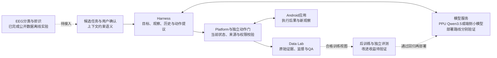

# Qwen3.5-2B 推理优化与脑机协同手机交互探索

整理日期：2026-10-14，Asia/Singapore。

用途：正式 PPT 的内容依据、叙事设计和团队对齐材料。本轮整理没有制作 PPTX，没有启动训练、云端服务或手机操作。既有实验数据的日期保留原始记录日期。

## 一、汇报定位

**基础任务是 Qwen3.5-2B 的推理优化。Android、Mobile GUI-VLA 和脑机接口属于应用探索与未来思考。**

建议主标题为“面向 PPU 的 Qwen3.5-2B 高效推理优化”，副标题为“Android 本地部署与脑机协同交互探索”。标题、开场、核心结果页和结尾都应首先落在指定模型与硬件优化上。

核心陈述：我们围绕指定 Qwen3.5-2B，建立真实部署与可复现评测，借助 profile 找到 PPU 上小算子、主机调度和频繁提交的瓶颈，以模型专用融合、提交边界和内存复用完成优化。在公开 CN20 同口径实验中，最终栈实现 2.71484 倍解码吞吐，TTFT 降低 4.79%，Accuracy 保持 85%。随后，我们通过 Android 本地小模型、GUI 智能体架构和离线脑电分类，探索这一模型能力的应用方向。

篇幅建议：基础任务约占 75% 的讲解时间，应用探索约占 20%，收尾约占 5%。应用部分不能挤掉量化路线、关键算子、实验门禁和最终结果的解释。

### 基础要求与已有成果的对应

| 要求或方向 | 我们已有的工作 | 可以汇报的结论 | 尚存边界 |
|---|---|---|---|
| 固定 Qwen3.5-2B 推理部署 | 模型 revision、哈希、真实 Transformers 后端；真实 PPU 驻留与图文生成 | 已有本地 GPU 与 PPU 实验依据 | 两种硬件数据分别标注 |
| 量化加速研究 | 量化格式、算子尺寸及运行时支持调查；A16W8/A16W4 等路线评估 | 完成路线分析，明确硬件与依赖约束 | 未取得可正式引用的全模型 PPU INT8/INT4 量化加速结果 |
| 算子与运行时优化 | HGGC 融合、packed MLP、acBLAS 提交、raw stream、b/a-GEMV、prefill 融合 | 有真实 PPU 模块与整模验证 | 各优化数字对应不同基线，不能直接叠加 |
| Accuracy、TTFT、Throughput | 全量精度审计、配对 A/B、独立进程 ABBA | 最终公开 CN20 总栈吞吐 2.71484 倍 | 不能外推为私有集成绩或全量总加速 |
| 可复现交付 | 代码、环境恢复、配置、源码白名单与结果入口 | 工程过程及结果可追溯 | 当前主办方最终通知与实际评分公式仍需以书面版本为准 |
| 应用加分项 | 端侧部署、受控动作闭环、GUI-VLA 架构、公开 EEG 数据实验 | 有具体探索与工程判断 | 尚无脑电到真实手机的贯通验证 |

如果原题最终要求独立提交“全模型量化”的验收结果，应把这一项列为基础任务缺口，优先于继续扩展 BCI/VLA。手机端采用公开 MNN 量化模型，不能补作赛事 PPU 量化成果。

## 二、完整叙事的因果关系

正式讲解建议按以下顺序展开：

1. **任务**：在指定模型、指定 PPU、固定评测接口下改善推理效率，并保持精度。
2. **基础**：固定模型与环境，建立真实基线，拆开 Accuracy、首 token 延迟和解码吞吐的测量。
3. **问题**：本地 CUDA 和 PPU 的热点不同，实际 PPU profile 指向小算子与提交开销。
4. **判断**：量化需要真实格式与 kernel 支持；优先选择已能在当前 PPU 环境中可靠验证的优化路径。
5. **方法**：先融合模型特有算子，再扩大 MLP/GDN 的提交边界，复用中间缓冲，优化流查询，单独处理 prefill。
6. **验证**：模块检查、固定长度配对、真实题目回归、双语完整集与独立进程复测分别承担不同验证任务。
7. **结果**：展示最终吞吐、TTFT 和 Accuracy 的同口径对照，明确证据范围。
8. **应用**：说明端侧部署与 GUI 操作的实际探索，再提出低带宽脑电输入如何接入任务系统。

应用部分的承接句：

> 完成指定模型的推理优化之后，我们进一步关注模型能否在真实交互中发挥作用。我们分别验证了手机端的受限执行能力和公开脑电数据的离线分类能力，并结合团队的 GUI-VLA 架构提出后续集成路径。

不要把“脑电驱动手机”当成前三分钟的主故事。前半段先让评委确认基础任务成果，后半段再展示延伸价值。

## 三、基础任务全过程

### 1. 模型、评测与工程基础

正式工程：`D:\GitHub\seu-vlm-ppu-optimization`。

- 指定模型：`Qwen/Qwen3.5-2B`。
- 固定 revision：`15852e8c16360a2fea060d615a32b45270f8a8fc`。
- 本地早期基线：RTX 4050 Laptop 6GB，真实 BF16 Transformers 推理。
- PPU 实验：PPU-ZW810E，BF16，batch size 1。
- 公开评测：MMBench 中文、英文 dev，各 4029 条。
- 正式接口：固定 wrapper 与 benchmark，保留文本、token 数、TTFT 和总耗时的含义。

前期完成模型下载及完整性检查、真实加载、数据结构检查、推理输出解析、分块运行与全量精度审计。`dummy` 只作为接口冒烟，不能进入真实结果表。

早期本地 GPU 全量精度：中文 3382/4029，83.94%；英文 3213/4029，79.75%。英文出现过截断结论无法解析，采用通用结论规范化并整块回放核验，不能把这项解析修复说成模型能力提升。

前期 O1 `torch.inference_mode()` 的本地三次中位结果：中文 TTFT 降低 8.25%、吞吐提高 8.82%；英文 TTFT 降低 10.22%、吞吐提高 6.37%，答案与 token 数保持一致。这是基线工程演进，主讲可简述，数字放备用页。

真实 PPU 部署证据包括：617/617 参数张量驻留 PPU 暴露的 `cuda:0`，无 CPU/meta/disk offload；真实图片、视觉主干、GDN、全注意力和自回归生成全部运行。修复 RTC 对 `PPU_SDK/PPU_HOME` 的路径依赖。SDK/vectorAdd 通过只是前置条件，真实模型闭环才构成部署成果。

### 2. Qwen3.5 的结构为何决定优化方式

锁定模型文本主干有 24 层，其中 18 层 GDN、6 层全注意力，按 3 个 GDN 加 1 个 Attention 的结构重复六组。

GDN 保存递推状态，全注意力保存 KV 历史，二者需要不同的实现与缓存策略。整个模型仍包含全注意力与 KV，不能讲成“完全没有 KV Cache”。

- **Prefill**：处理图像与文本输入，为第一个输出 token 建立上下文。
- **Decode**：按 token 重复状态更新和投影；batch size 1 下有大量小 GEMV、小算子与调度动作。

应把这页讲成“混合结构提供了模型专用融合机会”，无需在主讲完整推导 GDN 公式。

### 3. 两种硬件上的瓶颈认识

早期本地 CUDA profile 中，GEMV/GEMM 占 self CUDA time 86.18%。这指向矩阵运算的重要性，但不能直接作为 PPU 的瓶颈结论。

真实 PPU 的 16-token profile 则记录：self CPU 854.810 ms、self PPU 173.799 ms、37,293 次 kernel launch、8,832 次 `empty_strided`。这些是该 profile 范围内的事件与 self time，不能当作整个任务的墙钟延迟，也不能将 CPU/PPU self time 简单相加。

它支持的工程判断是：需要减少主机提交、短 kernel、中间张量和重复查询。自写 HGGC GEMV 虽比自有 reference 快 1.88–2.08 倍，仍比成熟 `torch.mv` 慢 16.7%–62.6%，因此没有替换进正式模型。

### 4. 量化路线必须单独回答

量化方向是基础任务的重要讨论，建议主讲保留一页，不能只在应用中提到“4-bit”。

讲清三个问题：量化什么、由什么 kernel 执行、如何检验最终收益。

- 权重 INT8/INT4 可能减少权重存储和带宽，但需要匹配 Qwen3.5 的投影形状和 PPU 算子实现。
- 激活、KV 或 GDN state 的低精度需要分别评估数值敏感性；已有量化格式名称不能证明整条模型可运行。
- 动态量化、反量化和额外调度也有成本，模块微基准不能代替全模型结果。
- 当时镜像缺少可直接采用的官方 acext/PPU-vLLM weight-only 依赖；正式报告没有可引用的 A16W8/A16W4 全模型量化结果。
- 规则限制未经认可的权重包，实际允许范围以主办方书面通知为准。

推荐讲法：

> 我们评估了量化路线的硬件支持与数值风险，在当前环境中优先完成了 BF16 下的融合与运行时优化。PPU 全模型 INT8/INT4 的性能和精度仍需专门验证。

这说明技术判断，也保留了基础任务的验收边界。手机 MNN 4-bit 的部署经验是独立应用成果，其使用的是现成公开量化模型，不应归为团队自研量化算法。

### 5. 正式优化路线

| 阶段 | 改动 | 作用机制 | 汇报重点 |
|---|---|---|---|
| 模型专用 decode 核 | recurrent GDN、causal-conv、RMSNorm、gated RMSNorm、Q/K norm + partial RoPE | 合并连续小算子，减少中间结果与提交 | 最大的首阶段解码收益 |
| MLP 布局打包 | gate/up 从两份投影组织为 packed storage；Parameter 以 view 引用 | 减少上层投影调用，避免常驻双份相同权重 | 布局与执行路径一起优化 |
| GDN 投影提交 | 一个 extension 入口按原顺序提交四个 acBLAS GEMV | 降低 Python/ATen/pybind 边界开销 | 一次入口可能仍有多个设备 kernel |
| residual 与 norm | 覆盖层内与跨层共 48 条残差后归一化边 | 消除单独 residual-add 提交 | profile 目标 add 720 次降至 0 |
| GDN gate-prep | 缓存常量，融合 sigmoid、softplus 等准备步骤，复用 scratch | 减少重复计算、转换、分配 | 在前一栈上获得全量配对增量 |
| 单入口 packed MLP | 一个入口组织 gate/up、SwiGLU、down 与 scratch | 扩大有意义的提交边界 | GEMV 数不变仍可提升整模效率 |
| raw stream 查询 | 使用当前运行时支持的直接 stream handle 查询 | 消除重复对象构造/查询 | 主要改善解码吞吐 |
| 保守 b/a-GEMV | 仅合并两个小投影，保留 qkv/z 形状 | 减少小 GEMV 提交并控制数值漂移 | 中英文 4029 条增量 exact 门禁通过 |
| multi-row prefill | 将已有 norm/residual 融合覆盖多行输入 | 单独缩短首 token 路径 | CN20/EN20 支持，无全量 TTFT 结论 |

可用于主讲的机制总结：

> 收益来自减少每个 token 重复发生的运行时开销，并针对模型结构扩大融合与提交边界。

五类 decode 融合的 CN20 吞吐由约 49.7 提高到约 94.9 token/s。后续完整集配对结果：gate-prep 在中文上中位提升 8.62%；单入口 packed MLP 在中英文分别提升 11.25%、10.93%；raw stream 在中英文分别提升 9.06%、9.01%；b/a-GEMV 中英文分别提升约 0.696%、0.697%。这些是各自相对前一栈的增量，不能简单相加或相乘后当作最终总加速。

Prefill 原始 JSON 中 CN20/EN20 的 TTFT 配对速度比分别为 1.04859x、1.04477x。“速度比高 4.86%”与“耗时降低 4.86%”公式不同。主结果页统一使用最终 ABBA 中直接重算的 TTFT 降低 4.79%，避免混用。

### 6. 失败路线与正式取舍

主讲用两个代表案例即可，其他放备用页。

- single-GEMV 合并四个 GDN 投影更快，但英文完整集正确数 3214 降到 3213，因此只保留为 `experimental_only`。正式采用更保守的 b/a-GEMV。
- acBLASLt 方阵模块级 1.2797x，整模固定长度只有 0.9898x；它说明局部算子更快不等于模型更快。

其他已保存方向包括独立 SwiGLU、Attention Prep、Graph Capture、scratch、workspace、KV 预留和视觉 token 缩减。最终没有启用已被门禁拒绝的分支，也没有以缩减视觉 token 替代正式推理优化。

这些记录体现的是有依据的取舍，不需要将所有失败日志搬上主讲页面。

### 7. 最终结果的唯一主表

来源：`results/ppu-final-best-vs-eager-cn20-abba-20260901.json`。

条件：同一 PPU-ZW810E、Qwen3.5-2B、BF16、batch size 1、固定中文公开前 20 题、每进程 2 条预热。四个独立进程按 eager A、candidate A、candidate B、eager B 的 ABBA 顺序运行，即每臂 2 次。汇总取两次运行平均指标的中位数。

| 指标 | 原始 eager | 最终栈 | 变化 |
|---|---:|---:|---:|
| 解码吞吐 | 49.2195 token/s | 133.623 token/s | 2.71484 倍，提升 171.48% |
| 平均 TTFT 的跨运行中位 | 120.059 ms | 114.313 ms | 降低 4.79% |
| Accuracy | 17/20，85% | 17/20，85% | 四次均一致 |
| 解析答案与正确性 | 20 题 | 20 题 | 20/20 一致 |

必须同时保留的范围说明：

- 这是公开 CN20 总栈性能结论，没有官方私有集排名依据。
- 总栈相对 eager 的 token 数只有 15/20 题在四次中一致。
- `benchmark_public` 输出未提供全文严格比较，因此不能宣称整栈全文 bit-exact。
- 后期某个增量在双语 4029 上 exact，只证明该增量相对其前一优化栈保持一致。

中英文 b/a-GEMV 完整集增量门禁的精度分别为 3374/4029（83.7429%）和 3214/4029（79.7717%），前后全文、答案、token 数各 4029/4029 一致。这个 PPU 配对实验与早期 RTX 4050 的 3382/4029、3213/4029 属于不同环境与版本，不应画成同一条 Accuracy 提升曲线。

2026-08-31 的 2.67907x 来自另一轮每臂四次的 ABBA 实验，可用于备用页说明重复验证；主图采用 2026-09-01 的 2.71484x，不能把两轮结果和运行次数混在一起。

### 8. 交付与工程能力

基础部分最后应展示可复现路径：固定版本与配置、隔离用户环境、复用 PPU 定制 Torch、重编译扩展、真实后端冒烟、固定入口评测、原始记录与聚合 JSON、源码白名单包。

代码和结果证明的是历史实验可追溯。本轮未部署到新 PPU 实例，未核验当前云资源或最新私有测评，不能说“今天服务已在线”或“已获得官方排名”。

## 四、应用探索如何接在主线之后

三个应用方向的联系是“高效模型推理服务于可验证交互”。它们的模型、硬件与成熟度不同，不能合并成一个已经部署的端到端系统。

| 路线 | 模型与位置 | 已有证据 | 在汇报中的职责 |
|---|---|---|---|
| 赛事优化 | Qwen3.5-2B BF16，PPU-ZW810E | 指定模型推理与性能 | 核心成绩 |
| Android 端侧原型 | 公开 Qwen3.5-2B-MNN HQQ 4-bit，手机 CPU | 真实部署与受控动作 | 端侧应用可行性 |
| 队友 GUI-VLA | 历史 Qwen3-VL-8B 服务等，Windows/Android/云端组合 | README 中的模块与历史诊断记录 | 系统能力与数据学习设计 |
| EEG 实验 | CSP-LDA、EEGNet 等，公开脑电离线数据 | 分类、个人校准、静息门控 | 新输入方式的探索 |

PPU 优化不能直接声称给手机 CPU 带来 2.7 倍加速；远端 Qwen3-VL-8B 不能称作优化后的 Qwen3.5-2B；手机动作也不能反证脑机闭环已经完成。

### 1. Android 本地部署与工作流尝试

工程：`C:\Users\ASUS\Downloads\zhi-ban-mobile-vla`。Xiaomi 17，Android 16；MNN Chat 0.8.3；公开模型 `taobao-mnn/Qwen3.5-2B-MNN` revision `35781816d7b6a9dcb273a6765ac9563401951c3c`。

使用现成 HQQ 4-bit 模型，block size 64。运行记录为手机 CPU，未验证 NPU。不能将整包所有子模块都一概写成 INT4，因为视觉与语言配置分别管理。

主要工作：

- 推送模型并核对关键权重，验证中文回答、图像理解和手机回环 API。
- 关闭/调整 Thinking，以减少简单任务中的长解释；仍观测到多轮会话稳定性问题。
- 建立结构化动作协议、独立确定性门、低风险白名单和执行后验证。
- 实现 AccessibilityService、手势、系统动作与 IME 中文输入桥。
- 实现 SQLite 工作流/知识提案、不可变轨迹、审核与版本回滚；RAG 演示的检索仍由主机完成，不能写成完整 Android 内置 RAG。
- 在预部署完成后关闭主机 ADB，验证手机独立选择打开 Settings、读取 125 个结构节点、返回桌面。证明的是正式运行阶段的独立性。
- 尝试受限电话、微信消息和视频工作流，记录成功与失败。

**最适合主讲的证据：受控三步连续视觉点击。**

| 步骤 | 目标 | 端侧模型选择 | 推理耗时 | 后果 |
|---|---|---:|---:|---|
| 1 | BLUE | 4 | 6827 ms | 状态转移通过 |
| 2 | GREEN | 1 | 3925 ms | 状态转移通过 |
| 3 | ORANGE | 3 | 5101 ms | 状态转移通过 |

任务总运行约 17.3 秒，三次推理合计 15.853 秒。手机执行了截图、视觉选择、安全门、点击和新状态确认；主机负责准备与事后读取证据。

这是四候选、三步、无外部副作用的测试。目标已知，门会复核模型选择与唯一目标边界；因此不能说任意 App 任务成功率达到 100%。截图未持久化，现有证据是验收日志，应明确标“来源：真机验收日志”。后续录制新视频时需独立标注新运行，不用生成图片伪装历史实机画面。

通信工作流分阶段：早期电脑辅助和单 Skill 路径有电话/消息/视频执行记录；更接近最终 Android Agent 的追加验收只有约 5 秒电话通过，微信文本因绑定指纹不稳定而停止，微信视频未启动。主讲不能概括成“三种通信功能全端侧稳定完成”。

固定录屏脚本 `run_continuous_demo.ps1` 使用固定坐标与等待，不依赖模型选择。它可以展示流程，但不能作为模型自主能力证据，也不能代替非 DryRun 的真实执行记录。

### 2. 队友的 Mobile GUI-VLA 架构

来源：2026-10-13 的 `README_Mobile_GUI_VLA_Architecture.md`，是一份架构与愿景说明，非全量验收报告。本轮按给定材料整理，没有重新连接远端或操作团队设备。

主讲保留六模块与双闭环，细节放备用页：

| 模块 | 职责 |
|---|---|
| Android Device / Apps | 提供真实界面和实际操作后果 |
| Platform | 截图/结构观察、设备适配、动作校验、执行与原始转移记录 |
| Harness | 组织目标与历史、按需查询、模型协议、动作提议与快慢路由 |
| Model Serving | 运行配置模型并保留请求/用量，不直接获得手机执行权限 |
| Data Lab | 人工/Student/Teacher 协作、任务编排、标注、QA、选择与导出 |
| Posttrain + Evaluation | 合格数据转换、LoRA-SFT、checkpoint 与匹配回归 |

在线闭环：目标和当前观察进入策略，策略提出动作，Platform 核验并执行，实际后果返回任务状态。

离线闭环：原始轨迹进入数据治理，经用途审阅形成训练视图，后训练产生候选模型，独立评测通过后再部署。在线历史只改变输入，训练才改变权重。

值得展示的思考包括：结构优先且按需视觉补充、默认概要与可查询细节、小模型和强模型分工、人工接管与回交、失败经验留痕、训练和评测独立。

已有接口、实验性实现与研究愿景要分别标注。README 对当前稳定多步泛化、快慢协作经济性、真实训练 checkpoint/reload 和训练收益都保留了缺口。8×RTX 4090 是训练环境提案，不能说已经执行八卡训练；Qwen3-VL-8B LoRA-SFT 是现有训练路线，不能说 Qwen3.5-2B 已完成 VLA 后训练。

“GUI-VLA”在本汇报中指视觉/语言理解与界面动作结合的智能体研究方向，不意味着已训练一个统一 VLA 模型。

### 3. 脑电驱动手机的前瞻性实验

指定历史对话：`codex://threads/01a0c7ff-b121-7f62-a405-1f78358c36d5`。本轮通过对应本地会话记录核对用户目标与末次校准解释，再核对 E 盘实验记录。

原始构想是脑电输入、任务表达、LLM/VLA 和手机操作。后来细化为：**脑电分类器提供有限离散候选，界面与工作流提供语义，用户确认后形成结构化任务，模型规划，执行器核验动作，设备反馈实际结果。**

这避免要求 EEG 从头解码自然语言或任意思想，也不让大模型根据二分类结果臆造用户想做的事。

历史工作已覆盖方案审阅和修正、公开 PhysioNet EEG 数据下载与预处理、传统 CSP-LDA 和 EEGNet、跨人分类、个人校准、静息检测、追加改进和结果可视化/总结。已有 Word 汇报仍可作细节参考。

四轮演进：v1 用 S001–S010 的 run04/run08/run12 跑通训练、验证、测试，各 150 试次；v2 扩展到同人不同记录和跨人两个协议；v3 给目标受试者做分类头个人适配并尝试静息拒识；v4 在固定协议下尝试对齐协方差、全网络微调、随机种子复跑与独立静息检测。第一轮 EEGNet 明显偏向左类，左类 71/77、右类仅 8/73，这也是采用平衡准确率和混淆矩阵的原因。

v2 同人协议为 S011–S080，训练/验证/测试分别 1049/1048/1050 试次；跨人协议以 S011–S080 训练、S081–S094 验证、S095–S108 测试，分别 3147/653/616 试次。这些数据划分与后续个人校准的 206 试次不能混淆。

结果必须按协议分开：

| 实验 | 数据与口径 | 结果 | 能说明什么 |
|---|---|---:|---|
| v1 CSP-LDA | 10 人同人不同记录，150 测试试次 | 58.71% | 小规模管线跑通 |
| v1 EEGNet | 相同 v1 协议，150 测试试次 | 51.58% | 接近随机且偏向左类 |
| v2 同人 CSP-LDA | 70 人、1050 测试试次 | 63.70% | 已见用户换记录的表现 |
| v2 同人 EEGNet | 相同 v2 同人协议 | 62.46% | 同人跨记录与跨人须分别评价 |
| v2 跨人 CSP-LDA | 616 个测试片段，平衡准确率 | 56.99% | 有限的公开数据分类基线 |
| v2 跨人 EEGNet | 同类跨人协议，616 片段 | 60.67% | 与传统路线的对照 |
| v3 EEGNet global | 14 人、206 个 run12 试次 | 57.57% | 个人校准前对照 |
| v3 EEGNet personal | 同一批 run12，分类头个人适配 | 63.40% | 比上述对照高 5.83 个百分点 |
| v4 对齐/协方差 | 固定 run12 协议 | 58.01% | 没有超过个人分类头基线 |
| v4 全网络微调 | 固定 run12 协议 | 60.98% | 没有超过个人分类头基线 |
| v4 分类头复跑 | 固定 run12 协议 | 63.40% | 未获得进一步方向识别提升 |

不同协议的百分比不能连成连续提升曲线。个人校准冻结 backbone 与 BatchNorm，只训练分类层；run04 用于校准，run08 用于验证并选择 epoch，run12 用于测试。14 人的汇总混淆矩阵是 `[[77,28],[47,54]]`，平衡准确率为 `(77/105 + 54/101)/2 = 63.3993%`。

静息门控展示了可靠性和覆盖率的取舍：204 个静息片段、206 个动作片段中，保守点接受 17 个动作，方向正确 14 个，另有 6 个静息误触发。17 个动作内条件正确率 82.35%，但动作覆盖率只有 8.25%；把静息误触发也计入后，全部 23 个候选中只有 14 个正确，即 60.87%。不能把 82.4%写成整体脑控准确率。

同一 run12 范围内旧门控只有 1/206 个动作输出、5/204 个静息误触发；新门控增加输出，也增加误触发。新门控的方向模块采用冻结的全网络微调模型，而 63.4% 是分类头个人校准基线，两者不能组合成一个已验收方案。保留分类头方向模型并接新静息模块，是后续需要验证的组合。

公开数据是同日期记录上的离线分析，固定测试人群在早期已被查看，追加改进属于探索性后续。没有现场采集本人脑电、跨日重新佩戴、持续无意图输入、实时流式验证、真实手机贯通或目标老年人测试。

主讲结论：方向分类仍有限，适合“主动开始识别、候选选择、人工确认”的低风险原型。后续应测误触发、覆盖率和完整任务后果，不能只追求一个更高的条件准确率。

## 五、未来构想的统一架构

建议未来系统由低带宽输入层、任务表达层、模型与策略层、设备执行层、数据学习层组成。下面的实线描述逻辑接口，虚线脑电连接表示尚待集成。图例须说明其他实线也不表示组合已端到端验收。

EEG 的左/右只是已实验的分类目标，不能直接解释成确认/取消/滚动等多个已训练命令。确认可先通过已有输入渠道完成；新增 EEG 范式或映射需要单独协议与验证。

例子仅作为方案：界面给出“打开提醒”和“阅读通知”两个固定低风险候选，用户主动触发 EEG 识别后选择其中一个，再确认具体任务。模型依据明确目标与当前页面规划动作，独立执行器核验后操作。它不是让模型把“左手意图”自由翻译成拨号、支付或发消息。

可选云端、边缘或手机部署，并不改变模块职责。若以后用优化后的 PPU Qwen3.5 承担复杂规划，要重新适配模型协议、验证动作能力并测任务成本。现有 PPU MMBench 加速不能直接宣称 GUI 成功率改善。

完整交互延迟至少包含识别窗口、确认、网络、观察、prefill、decode、动作执行与后果验证。当前 PPU 数字只覆盖特定推理测量，2.71484 倍解码吞吐不是手机完整任务的加速倍数。

## 六、正式汇报的贡献层级

| 层级 | 汇报重点 | 证据形式 |
|---|---|---|
| 第一层：基础任务成果 | 指定模型真实 PPU 部署、瓶颈分析、算子与运行时优化、精度门禁、最终对照、可复现交付 | JSON、profile、代码与实验记录 |
| 第二层：工程延伸 | Android 量化模型部署、运行时独立性、受控视觉点击、明确失败与恢复 | 真机验收日志与已有脱敏材料 |
| 第三层：团队系统思考 | GUI-VLA 六模块、在线/离线闭环、数据治理、快慢协作与评测设计 | 架构概述与版本化实验说明 |
| 第四层：前瞻研究 | 公开 EEG 分类与个人校准、候选确认原型、未来集成 | 离线数据结果与待验证路线 |

第一层应单独构成完整答辩，即使评委没有听应用部分，也能判断基础任务内容与完成度。后三层提供加分信息，不能代替第一层的结果或缺项。

## 七、后续安排与制作约束

优先顺序：先冻结基础任务的最终数字和量化验收口径，再制作可编辑结果图、热点与融合原理页；随后补应用部分的真实证据和成熟度图，最后形成正式 PPT 和口播。

短期验证顺序：

1. 核对最新赛题书面通知、答辩时长和量化是否单独验收；未核对前不写当前评分权重或最终排名。
2. 基础实验如需新环境复现，保持同一模型、硬件与评测协议，补齐原始归档检查。
3. 手机只扩展无外部副作用的受控任务，统计全部启动尝试和失败，避免用固定脚本代替模型选择。
4. EEG 先离线回放接入候选界面，并独立记录拒识、覆盖率、误触发和确认结果；回放演示明确标注回放。
5. 再采集现场校准与新的跨日测试，最后才验证脑电到手机的实时闭环。
6. VLA 的后训练必须使用合格来源数据、真实 checkpoint/reload 和匹配回归，证明改善后再部署。

主讲视觉：一页一个问题，结果图采用可编辑数值与源数据，实机证据采用真实脱敏材料。旧 P05/P07/P13 图稿可作为参考，但需逐项核对标签、连线和成熟度。新的 BCI 结果已经产生，旧方案中“脑电只是待训练设想”的状态也需更新为“离线分类已完成、真实贯通待验证”。

## 八、建议开场与收尾

开场：

> 我们的核心任务是在指定 PPU 上优化 Qwen3.5-2B 的多模态推理。我们先建立真实基线，再通过实际 profile 定位瓶颈，以模型专用算子融合和运行时优化提升解码吞吐，同时检查准确率与输出一致性。完成基础工作后，我们又探索了手机端部署和脑机协同交互的应用方向。

结果页：

> 在相同 PPU、相同模型和固定中文公开 20 题上，四个独立进程的 ABBA 对照显示，最终栈解码吞吐为原始 eager 的 2.71484 倍，TTFT 降低 4.79%，四次 Accuracy 均为 85%。这里的结论范围是 CN20，全文一致性没有得到总栈验证。

应用页：

> 手机端已经完成受控三步视觉点击，公开脑电数据已经完成离线分类。团队的 GUI-VLA 架构提供观察、执行、数据和评测的组织方式。下一步是把有限脑电候选接到有确认机制的任务入口，并用真实结果逐段验证。

收尾：

> 我们的主要成果是 Qwen3.5-2B 在真实 PPU 上的可复现推理优化。Android 与 EEG 实验让我们看到应用机会，也明确了识别可靠性、设备状态和系统集成的缺口。后续将先完成基础任务验收，再推进可确认、可评测的辅助交互原型。
